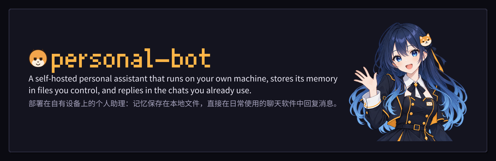
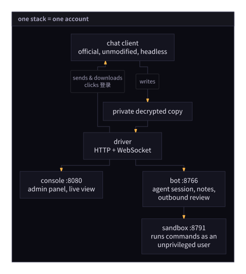

<div align="center">

# personal-bot



**A self-hosted personal assistant that runs on your own machine, stores its
memory in files you control, and replies in the chats you already use.**

[Docs site](https://4fuu.github.io/personal-bot/) ·
[Quick start](#quick-start) ·
[First start](#first-start) ·
[Configuration](#configuration) ·
[What it can do](#what-it-can-do) ·
[How it works](#how-it-works) · [Disclaimer](#disclaimer)

</div>

> **Warning:** This project drives a third-party desktop client, which violates
> that client's terms of service and can get an account restricted or banned.
> Use a secondary account with existing history, a residential connection, and
> the default send pacing. This is a private research project provided as is;
> you bear all risk. Read [DISCLAIMER.md](DISCLAIMER.md) before running
> anything.

---

## What it is

The stack runs four containers for a single chat account: one runs the desktop
chat client on a virtual display, one runs the assistant, one serves the web
console you manage it from, and one provides an isolated sandbox where the
assistant's shell commands run.

<p align="center">
  
</p>

- **Reading messages.** Incoming messages land in the client's local database
  within a couple of seconds, and the driver reads them from there.
- **Sending and media download.** Outbound text, built-in faces, images,
  stickers, files, @mentions, and quote replies go through the client's own
  send path, paced by a single action queue with randomized human-like delays.
  When the assistant needs a received image or file that is not on disk yet,
  the driver asks the client to download it.
- **No modified files.** No client file on disk is ever patched, replaced, or
  modified. [DISCLAIMER.md](DISCLAIMER.md) describes exactly how the stack
  interacts with the client.

### The chat backend

The backend is the **official QQ NT desktop client for Linux** (pinned to the
build recorded in the release notes), running unmodified on a TigerVNC virtual
display inside the `qq` container. Everything the assistant reads comes from the
client's local database (plus on-demand downloads of
received media for messages the assistant reads), and every message it sends
goes through the client's own send path.

The stack does not subscribe to the client's incoming event stream and does not
use any third-party protocol reimplementation. The console's live view streams
the client's actual display, so you can scan a QR code to sign in and see what
the client is doing at any time.

## What it can do

- **Chat naturally.** Replies to private messages and group @mentions; in groups
  where you allow it, it can also join ongoing conversations on its own. Each
  conversation has its own policy in the console.
- **Send rich messages.** Sends text (including the client's built-in faces),
  stickers (and saves ones it likes from chat), images, and files, with support
  for quote replies and @mentions.
- **Read chat content.** Searches and reads message history, views images,
  downloads files shared in chat, and reads voice messages and merged forwards.
- **Keep long-term memory.** Writes and updates its own notes, and searches its
  past context windows and action history.
- **Follow up later.** Can pause and check back after a minute to a day, leave
  wake words that reopen a conversation when mentioned within six hours, run
  scheduled tasks configured in an admin's private chat, and take optional free
  turns when everything has been quiet for a configured period.
- **Use external tools.** Searches the web and reads web pages, runs shell
  commands and edits files inside an isolated sandbox whose only internet access
  is a domain-filtering proxy, chains calls in JavaScript scripts, uses
  installed skills, and connects to MCP servers (with per-server and
  per-function switches in the console).
- **Manage everything from one console.** Includes the live client screen and
  login controls, conversation policies, persona editor, memory browser,
  sticker manager, scheduled tasks, model and provider logins, safety and
  network rules, workspace settings (environment variables, skills, MCP
  servers), advanced timing controls, and a live event log.

## How it works

Each account runs as a single long-lived agent session that processes one turn
at a time. A turn can be triggered by incoming messages, a wake word, a timer
coming due, a scheduled task, or an idle free turn. Incoming messages in a chat
are briefly batched before a turn starts; in group chats,
[Jev](https://typesafe.ai/) evaluates whether joining the conversation is
natural. Messages that arrive while a turn is already running are handed to
that turn between tool calls.

Instead of an ever-growing transcript, working memory is organized as a sequence
of context windows with a token budget. As a window fills up, the host appends
staged reminders prompting the assistant to update its notes and write a concise
four-part handoff (current topics, progress, open to-dos, and agreements)
before rolling over to a fresh window.

Notes are the assistant's long-term memory. Each note has a short summary and
shares the window's token budget. At every rollover, the host selects an active
set of notes (admin-pinned notes, notes written or edited in the closing
window, and the most-used notes) and injects their summaries into the new
window alongside the handoff and recent chat messages, while older notes and
past windows remain searchable on demand.

[Jev](https://typesafe.ai/) never writes reply text. It only answers structured
yes/no and multi-level scoring questions—such as whether to join a group chat,
how long to wait before replying, which waiting chat goes first, whether to
quote a message, whether an outbound bubble leaks a secret or repeats recent
replies, whether a new domain requested by the sandbox should be allowed, and
how likely a candidate note is to be needed in the next window.

For a deeper look—and a side-by-side comparison of context and memory handling
against AstrBot, MaiBot, DeepSeek Harness, and pi—see
[docs/how-it-works.md](docs/how-it-works.md).

## Requirements

- Linux x86_64 (or macOS / Windows running a Linux VM).
- Docker 24+ or Podman 4+ with `compose`.
- Roughly 2 GB of RAM and 5 GB of disk space for the container images and client
  profile.
- A secondary account on the chat platform with some prior history (avoid brand-new
  accounts).
- An API key or account login for any vision-capable model provider supported by
  [pi](https://pi.dev) (Anthropic, OpenAI, OpenRouter, DeepSeek, and others), plus
  a [Jev](https://typesafe.ai/) API key for outbound review and gating.

## Quick start

```sh
git clone https://github.com/4fuu/personal-bot.git
cd personal-bot
cp .env.example .env
```

Open `.env`, set a strong `CONSOLE_PASSWORD`, generate the three internal tokens
with `openssl rand -hex 32`, and configure one of the two QQ package sources
(see [First start](#first-start)).

```sh
mkdir -p data/driver/secrets data/bot/pi data/bot/secrets workspace logs
sudo chown -R 1000:1000 data/bot workspace logs
docker compose up -d
```

Open <http://localhost:8080>, sign in with `CONSOLE_PASSWORD`, go to the **QQ**
page, and scan the QR code in the live view using the mobile app. Check
**自动登录** so future container restarts sign back in automatically.

The first login takes several minutes while the driver extracts the local
database key (up to about 8 minutes on a virtual display).
Once extraction finishes, the database key status in the console changes to
**密钥正常** (**正常** on the **QQ** page).

If you use rootless Podman, run
`podman unshare chown -R 1000:1000 data/bot workspace logs` once after creating
the directories instead of `sudo chown`.

## First start

The container images do not bundle QQ. On its first start, the `qq` container
installs the pinned `.deb` package from **exactly one** of two sources:

| Source | How to configure it |
| --- | --- |
| Download URL | Set `QQ_DEB_URL=https://example.com/QQ_3.2.34_260924_amd64_01.deb` in `.env` |
| Local `.deb` file | Uncomment the `/qq/QQ.deb` volume mount in `compose.yaml` and leave `QQ_DEB_URL` empty |

In both cases, the container checks the file's SHA-256 digest against the hash
baked into the image and **refuses to install any other build**, printing the
expected version and digest on mismatch. The installed files are stored in the
`qq_install` volume, so subsequent starts skip installation. If neither source
is provided—or if both are set—the container exits immediately and prints both
options.

> The official download server returns `403` unless the URL is signed. If you
> download the `.deb` from a mirror, verify its SHA-256 yourself and mount it at
> `/qq/QQ.deb` in `compose.yaml` (or serve it over HTTP from an address
> reachable by the container and set `QQ_DEB_URL`).

## Configuration

Every environment variable is documented in [.env.example](.env.example):

| Variable | Purpose |
| --- | --- |
| `CONSOLE_PASSWORD` | Password for the web console (the only port published outside the stack) |
| `DRIVER_TOKEN`, `BOT_TOKEN`, `SANDBOX_EXEC_TOKEN` | Internal authentication tokens between services; generate each with `openssl rand -hex 32` |
| `QQ_DEB_URL` | HTTP(S) URL for downloading the pinned QQ `.deb` on first start (leave empty when mounting `/qq/QQ.deb`) |
| `PI_OFFLINE` | Set to `1` to disable fetching the online model catalog from `pi.dev` |
| `KEYX_TIMEOUT_S` | How long first boot waits for database key extraction before continuing in the background (default `900` seconds) |
| `PERSONAL_BOT_TAG` | Image tag to run; leave empty for `latest`, or set a release tag such as `v2026.1025.0` to pin a version |

All assistant behavior settings—model selection, conversation allowlists and
policies, persona, memory limits, and allowed sandbox domains—are configured in
the web console rather than in `.env`.

## Where the data lives

| Host path / volume | Container path | Contents |
| --- | --- | --- |
| `./data/driver` | `/data/driver` | Extracted database key (`secrets/db_key`, mode `0600`), message mirror (`mirror.db`), driver config (`config.json`) |
| `./data/bot` | `/data/bot` | Agent state and notes (`bot.db`), model credentials (`pi/auth.json`, mode `0600`), secret store (`secrets/`), saved stickers (`stickers/`) |
| `./workspace` | `/workspace` | Files created or read by the agent, installed skills, staged chat files, and full copies of truncated tool outputs |
| `./logs` | `/out` | Diagnostic logs from the `qq` container (`qq.log`, `keyx.log`, `novnc.log`) |
| `qq_profile` (volume) | `/home/qq/.config/QQ` | Client profile: login session, encrypted databases, and media cache |
| `qq_install` (volume) | `/opt/QQ` | Installed QQ client binary and resources |

`./workspace` is mounted only into `bot` and `sandbox`. The sandbox has no other
mounts—it cannot read the message mirror, `bot.db`, credentials, or client
files—and sits on an internal Docker network (`sandbox_net`) with no direct
internet gateway. Every outbound connection from the sandbox must pass through
the bot's HTTP(S) egress proxy.

The files under `./logs` contain runtime diagnostics from the `qq` container and
may include chat text; keep them private and redact personal content before
sharing excerpts.

## Updating

```sh
docker compose pull
docker compose up -d
```

Your data, login session (`qq_profile`), and installed client (`qq_install`)
all live on persistent mounts and volumes, so recreating the containers preserves
them. If a new release updates the pinned QQ version, remove the `qq_install`
volume before starting the new images so the updated client build is installed.

## Connecting an MCP client

The assistant can connect to MCP servers over OAuth 2.1. Servers that support
**Client ID Metadata Documents** (CIMD) take a public HTTPS URL as the
`client_id` and fetch a JSON document from that URL to discover the client's
name and allowed `redirect_uris`. Because `client_id` must match the exact URL
the document was fetched from, each console origin needs a matching document.

**Option 1: Cloudflare Worker (recommended).** The [`cimd-worker/`](cimd-worker/)
directory contains a zero-dependency Worker that encodes a caller-chosen ID and
your console's origin in the URL path:

```
https://personal-bot-cimd.popoi.work/<id>/http/localhost:8080/mcp-client.json
```

When requested at that URL, it returns the metadata document for a console at
`http://localhost:8080`:

```json
{
  "client_id": "https://personal-bot-cimd.popoi.work/<id>/http/localhost:8080/mcp-client.json",
  "redirect_uris": ["http://localhost:8080/mcp/oauth/callback"]
}
```

Generate `<id>` once with `openssl rand -hex 16` (16–64 characters using
`A-Z a-z 0-9 _ -`, with at least one letter and one digit) and **keep using the
same ID**: it forms part of the `client_id` registered with the MCP server, and
keeps two users who both access their consoles at `http://localhost:8080` from
colliding on the same `client_id`. Any `http` or `https` origin (including
`localhost`) works. To self-host the Worker on your own Cloudflare account:

```sh
cd cimd-worker
CLOUDFLARE_API_TOKEN=<token-with-workers-deploy-permission> npx wrangler deploy
```

**Option 2: Static file on GitHub Pages.** This repository also includes a
static [`mcp-client.json`](mcp-client.json) published at the root of the docs
site:

```json
{
  "client_id": "https://4fuu.github.io/personal-bot/mcp-client.json",
  "redirect_uris": ["http://localhost:8080/mcp/oauth/callback"]
}
```

This static file works as-is only when you open the console at
`http://localhost:8080`. If you access the console through another origin (a
custom domain, tunnel, or different port), either use the Worker above or fork
the repository, update `client_id` and `redirect_uris` in `mcp-client.json`, and
let the GitHub Pages workflow publish your copy.

**Option 3: Dynamic or manual registration.** If you prefer not to use a
metadata URL, you can select **动态注册** (dynamic client registration, when the
MCP server supports it) or **预先注册的 client id** (a manually registered client
ID and optional secret) when adding the server on the console's **工作区** page.

## Troubleshooting

| Symptom | Cause and fix |
| --- | --- |
| `error: no QQ source: set exactly one of ...` | Neither `QQ_DEB_URL` nor a mounted `/qq/QQ.deb` was provided; see [First start](#first-start) |
| `error: sha256 mismatch: expected ... got ...` | The `.deb` file does not match the pinned QQ build; download the exact pinned version |
| `error: both QQ_DEB_URL and the mounted deb ... are set` | Both sources are configured; keep only one |
| Live view stays on the QR code screen | Normal on first login—scan the QR code with the mobile QQ app |
| Database key shows **密钥缺失** | Key extraction is still running; check `./logs/keyx.log` on the host. The driver keeps watching and switches to **密钥正常** automatically once the key is written |
| Console pages return `502` | The `qq` or `bot` container is still starting up; check `docker compose logs qq bot` |

## License

See [LICENSE](LICENSE). Free to run for your own use; redistribution or resale
of the container images is not permitted. Provided without warranty; you assume
all risk for your account and data.

## Disclaimer

See [DISCLAIMER.md](DISCLAIMER.md). This project is not affiliated with or
endorsed by Tencent or QQ, is provided as is, and must not be used for any
unlawful purpose.
