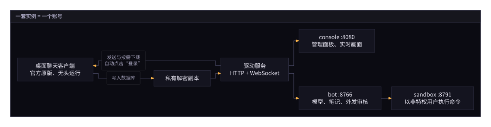

::: warning 运行前必读
本项目通过驱动第三方桌面客户端运行，不属于该客户端服务条款允许的范围，可能导致账号受限或封禁。请使用已有正常使用记录的小号，在家庭宽带环境下运行，并保持默认的发送节奏。本项目为个人研究项目，按“现状”提供，一切风险由使用者自行承担。运行前请先阅读[免责声明](./guide/disclaimer)。
:::

## 项目架构

整套服务由四个容器组成，一套实例对应一个账号：`qq` 容器在虚拟屏幕中运行官方桌面客户端，`bot` 容器运行模型，`console` 容器提供 Web 管理面板，模型的命令行操作则在隔离的 `sandbox` 容器中执行。

  

## 从这里开始

- [快速开始](./guide/quick-start)：环境要求、克隆仓库、配置 `.env`、启动容器。
- [首次启动与扫码登录](./guide/first-start)：QQ 安装包来源、数据库密钥提取与手机扫码登录。
- [环境变量（.env）](./guide/env)：`.env` 中各项变量的完整说明。
- [控制台指南](./guide/console/)：管理面板各个页面的功能与设置项说明。
- [MCP 客户端（OAuth）](./guide/mcp)：通过 OAuth 2.1 将模型注册到外部 MCP 服务器。

## 支持 [pi](https://pi.dev) 生态内的全部模型

模型运行在 [pi](https://pi.dev) 框架之上，支持 pi 集成的所有模型服务商与视觉模型。在控制台的[模型与 Jev](./guide/console/models)页面即可登录服务商或配置 API key。模型目录在服务启动时自动拉取，此后每天自动刷新一次（设置 `PI_OFFLINE=1` 时关闭联网拉取），也可随时在页面顶部手动刷新，新发布的模型无需重启容器即可选用。

完整项目说明见仓库 [README](https://github.com/4fuu/personal-bot)；轮次、上下文与记忆机制的详细对比见 [docs/how-it-works.zh-CN.md](https://github.com/4fuu/personal-bot/blob/main/docs/how-it-works.zh-CN.md)。

<!--
  控制台截图只允许用 apps/console 的 mock 模式（合成数据）拍摄，放在 public/ 下。
-->
